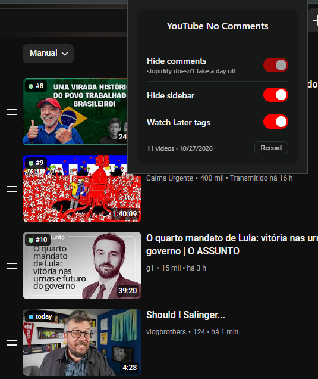

  <h2>
    Little tweaks
  </h2>
  <h1>
    Chrome Extensions Pack
  </h1>

<a href="README.pt-BR.md">🇧🇷 Ler em Português</a>

## :pencil: Description
A collection of small extensions for **Google Chrome** that ~~do almost nothing~~ fix specific everyday annoyances. They're simple, lightweight, and focused on making a single change that used to bother me.

## :gear: Installation
Since these extensions aren't published on the Chrome Web Store, installation is manual.

1. Open `chrome://extensions/`
2. Enable **Developer mode**, top right corner.
3. Click **Load unpacked**.
4. Select the `files` folder of the extension you want.
5. Done!

## :jigsaw: Extensions

### 💬 Minimalist WhatsApp
Lets you hide dozens of WhatsApp Web elements, organized into tabs in the extension popup:
- **Navbar** — Calls, Status, Channels, Communities, Divider, Meta AI, Footer icons. Shortcut "Entire header" locks and force-hides everything in this tab.
- **Chatlist** — Drawer title, New chat button, Search bar, Filters, Locked chats, Encryption info, Intro panel.
- **Chats** — Message details, Last message.

The popup language (English/Portuguese) is detected automatically from your browser.

### 📌 Pinterest Feed Width Control
Lets you control the width of the Pinterest feed, reducing the number of columns shown, and adds a dark mode toggle since Pinterest doesn't have one.
- Adjust the feed width with a **slider** in the extension popup — changes apply live, no reload needed.
- Toggle **dark mode** for Pinterest itself, straight from the popup.

The popup language (English/Portuguese) is detected automatically from your browser.

### 🤫 Youtube No Comments
Permanently hides comments on every YouTube video. As a bonus, it removes every sidebar item except **Home**, **Subscriptions**, **History**, **Playlists**, and **Watch later**.

It also tags each video in your **Watch later** playlist with how long it has been waiting. YouTube doesn't expose the date a video was added, so you record the order once (sort by *Date added (oldest)*, then turn on **Watch Later tags** in the popup and press **Record**). Those videos show "#N", and videos added afterwards show the real number of days. A colored dot shows how long a video has been waiting: blue (under 7 days), green (7 to 13), orange (14 to 29) and red (30 or more). The "#N" tags use the same colors by thirds of the list, with the oldest third in red.

The popup language (English/Portuguese) is detected automatically from your browser.

 

