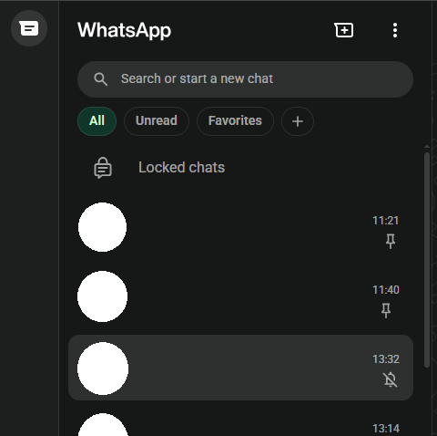
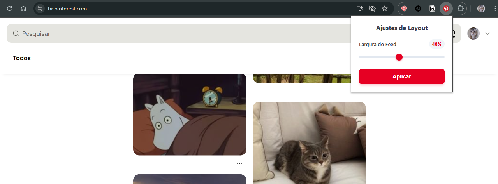
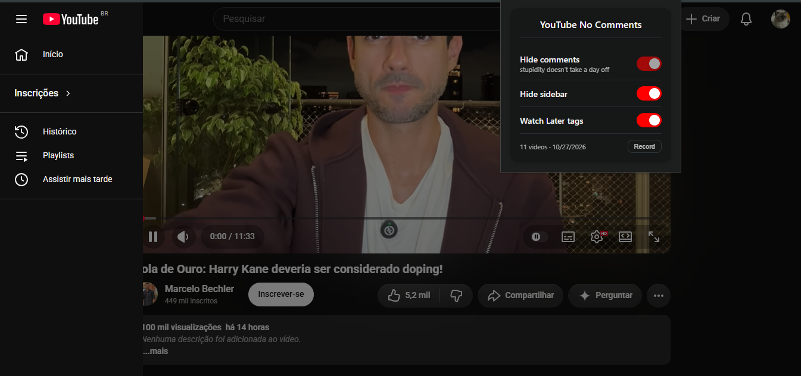

  <h2>
    Pequenos ajustes
  </h2>
  <h1>
    Chrome Extensions Pack
  </h1>

<a href="README.md">🇬🇧 Read in English</a>

## :pencil: Descrição
Coleção de pequenas extensões para o **Google Chrome** que ~~fazem quase nada~~ resolvem incômodos específicos do dia a dia. São simples, leves e focadas em fazer uma única mudança estética que me incomodava.

## :gear: Instalação
Como as extensões não estão publicadas na Chrome Web Store, a instalação é manual.

1. Abra `chrome://extensions/`
2. Ative o **Modo do desenvolvedor** (Developer mode), no canto superior direito.
3. Clique em **Carregar sem compactação** (*Load unpacked*).
4. Selecione a pasta files da extensão desejada.
5. Pronto!

## :jigsaw: Extensões

### 💬 WhatsApp Minimalista
Permite ocultar dezenas de elementos do WhatsApp Web, organizados em abas no popup da extensão:
- **Navbar** — Chamadas, Status, Canais, Comunidades, Divisor, Meta AI, Rodapé. Atalho "Cabeçalho inteiro" trava e força a ocultação de tudo dessa aba.
- **Lista de conversas** — Título, Botão nova conversa, Barra de busca, Filtros, Conversas trancadas, Aviso de criptografia, Painel inicial.
- **Conversas** — Detalhes da mensagem, Última mensagem.

O idioma do popup (Português/Inglês) é detectado automaticamente a partir do navegador.

### 📌 Controle de Largura do Feed do Pinterest
Permite controlar a largura do feed do Pinterest, reduzindo a quantidade de colunas exibidas, além de um toggle de modo escuro, já que o Pinterest não tem um nativo.
- Ajuste da largura do feed através de um **slider** no popup da extensão — as mudanças são aplicadas na hora, sem precisar recarregar a página.
- Ative o **modo escuro** no Pinterest direto pelo popup.

O idioma do popup (Português/Inglês) é detectado automaticamente a partir do navegador.

### 🤫 Youtube Sem Ruído
Tira a poluição do YouTube:
- **Comentários** — sempre ocultos.
- **Barra lateral** — só ficam **Início**, **Inscrições**, **Histórico**, **Playlists** e **Assistir mais tarde**.
- **Posts da comunidade** — ocultos no feed, nas abas Posts dos canais e nas seções da página inicial.
- **Descoberta de novos temas** — oculta a seção "Descoberta avançada de novos temas" da página inicial.

**Recurso extra:**
- **Tags do Assistir mais tarde** — mostra há quanto tempo cada vídeo espera, com uma bolinha colorida do azul (novo) ao vermelho (30+ dias). Ative no popup e clique em **Gravar** uma vez, com a lista ordenada por *Data de inclusão (mais antigo)*.

O idioma do popup (Português/Inglês) é detectado automaticamente a partir do navegador.

 

